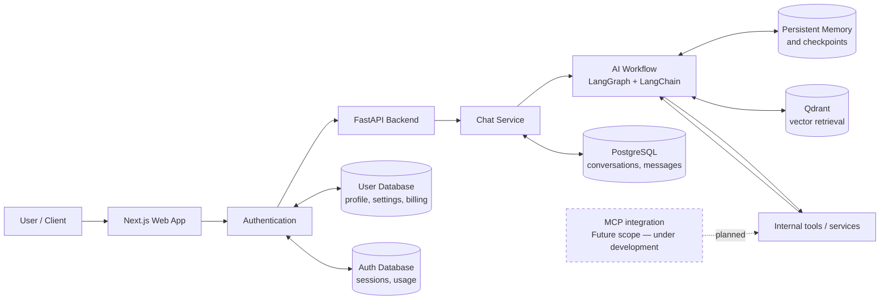
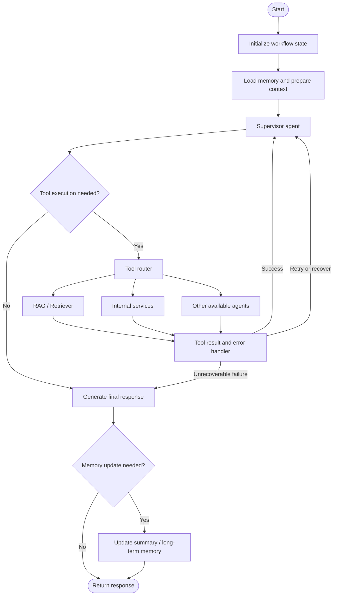
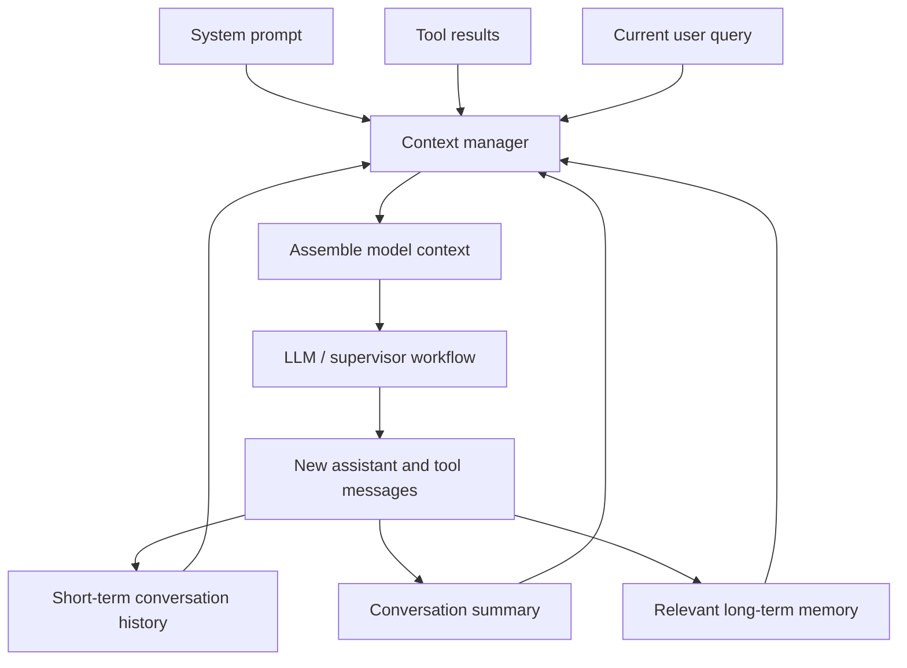

<div align="center">

# NOVA — Multi-Agent Workflow Platform

**An AI assistant platform for orchestrating complex tasks with agent workflows, retrieval-augmented generation, and persistent memory.**

[](https://www.python.org/)
[](https://fastapi.tiangolo.com/)
[](https://www.langchain.com/langgraph)
[](https://qdrant.tech/)
[](https://www.postgresql.org/)
[](https://www.docker.com/)

[**Live Application**](https://novaagent-by-parth.vercel.app/) · [**Repository**](https://github.com/ParthDhengle/NOVA)

</div>

---

## Overview

NOVA is a multi-agent AI assistant that processes user requests through a supervisor-led workflow. It combines agentic retrieval-augmented generation (RAG), tool execution, conversation history, and persistent memory to support context-aware interactions.


## Key Features

- **Supervisor-based orchestration** — routes requests through a LangGraph workflow and invokes tools when needed.
- **Agentic RAG** — retrieves relevant information from a Qdrant vector store to support grounded responses.
- **Context management** — combines the current query, recent messages, summaries, system instructions, tool results, and relevant long-term memory.
- **Persistent state** — uses PostgreSQL for conversation data and LangGraph checkpointing.
- **Tool execution and error handling** — routes tool requests, handles failures, and returns results to the supervisor.
- **Cloud deployment** — backend containerized with Docker and deployed on AWS, with GitHub Actions for build/deployment automation.

## Architecture

The diagrams below describe the intended system boundaries and workflow. They should be kept aligned with the implementation as the project evolves.

### 1. System architecture



**Component responsibilities**

| Component | Responsibility |
|---|---|
| Next.js web app | User-facing chat and application interface |
| FastAPI | Backend API and request handling |
| LangGraph / LangChain | Workflow orchestration and LLM integration |
| PostgreSQL | Persistent application data and workflow checkpoints |
| Qdrant | Vector search for RAG and relevant memory retrieval |
| AWS + Docker | Containerized backend deployment |


### 2. Agent execution workflow



**Request lifecycle:** prepare context → supervisor decision → optional tool execution → response generation → memory update.

The supervisor/tool loop allows the workflow to gather information or execute actions before producing a final answer. Actual retry limits and failure policies depend on the backend implementation.

### 3. Context management



NOVA uses a hybrid context strategy: recent messages provide immediate conversational detail, while summaries and retrieved long-term memory help preserve relevant information across longer interactions. The exact context window and summarization thresholds are configurable implementation details.

## Technology Stack

| Layer | Technologies | Purpose |
|---|---|---|
| Web frontend | Next.js, TypeScript | User-facing web application |
| API backend | Python, FastAPI | API endpoints and application services |
| Agent orchestration | LangGraph, LangChain | Stateful workflow and LLM integration |
| Tracing / evaluation | LangSmith | Workflow tracing and debugging, where configured |
| Vector retrieval | Qdrant | Semantic search for RAG |
| Persistence | PostgreSQL | Conversations, memory, and checkpoints |
| Packaging | Docker | Reproducible backend container |
| Deployment | AWS ECS, ECR, RDS | Container runtime, registry, and managed PostgreSQL |
| CI/CD | GitHub Actions | Automated build and deployment workflow |

## Local Development

### Prerequisites

- Python and Node.js versions compatible with the project
- PostgreSQL
- Qdrant
- Git
- Docker (for container-based development)

### 1. Clone the repository

```bash
git clone https://github.com/ParthDhengle/NOVA.git
cd NOVA
```

### 2. Configure environment variables


**1. Backend environment variables**

Create `backend/.env` using `backend/.env.example` as a template and configure the required API keys, database URLs, and application settings.

```bash
# backend/.env.example

GEMINI_API_KEY=your_gemini_api_key
GROQ_API_KEY=your_groq_api_key
SERPER_API_KEY=your_serper_api_key

SQLALCHEMY_DB_URL=your_application_database_url
LANGGRAPH_DB_URL=your_langgraph_database_url

MAX_TOKENS=100000
KEEP_MESSAGES=8

LANGSMITH_API_KEY=your_langsmith_api_key
LANGSMITH_TRACING=true
LANGSMITH_ENDPOINT=your_langsmith_endpoint
LANGSMITH_PROJECT=NOVA

ACCESS_TOKEN_EXPIRE_MINUTES=30
ALGORITHM=HS256
SECRET_KEY=replace_with_a_secure_random_secret
```

Generate a secure secret key using Python:

```bash
python -c "import secrets; print(secrets.token_urlsafe(32))"
```

Store the generated value in your private `backend/.env` file. Never commit secrets or credentials to Git.

**2. Frontend environment variables**

Create `frontend/.env.local` using `frontend/.env.local.example` as a template.

```bash
# frontend/.env.local.example

NEXT_PUBLIC_API_URL=http://localhost:8000
```

Update `NEXT_PUBLIC_API_URL` if your backend runs at a different URL.


### 3. Start the Application


### Backend Setup (Windows PowerShell)

**1. Navigate to the backend directory**
```powershell
cd backend
```

**2. Create and activate a virtual environment**
```powershell
python -m venv venv
.\venv\Scripts\Activate.ps1
```

**3. Install dependencies**
```powershell
pip install -r requirements.txt
```

**4. Start the FastAPI server**
```powershell
uvicorn main:app --reload
```

The API will be available at:
- **API:** http://127.0.0.1:8000
- **Swagger UI:** http://127.0.0.1:8000/docs
- **ReDoc:** http://127.0.0.1:8000/redoc


### Frontend Setup

**1. Navigate to the frontend directory**
```powershell
cd frontend
```

**2. Install dependencies**
```powershell
npm install
```

**3. Start the development server**
```powershell
npm run dev
```

The frontend will typically be available at:
- **Application:** http://localhost:3000

## Deployment

The backend deployment uses Docker and AWS services:

1. Build the backend container image.
2. Push the image to Amazon ECR.
3. Run the container through Amazon ECS.
4. Connect the backend to PostgreSQL on Amazon RDS.
5. Supply secrets through AWS Secrets Manager or the deployment environment.
6. Use GitHub Actions to automate the configured build and deployment steps.
7. Inspect CloudWatch logs when troubleshooting runtime or connectivity failures.

Keep database credentials and service endpoints in environment configuration rather than hardcoding them into source code.


## Future Scope

The following capabilities are planned or under development and are not available in the current version.

- [ ] MCP integration for standardized external tool connectivity
- [ ] MCP resource and file-attachment support
- [ ] Input/output guardrails and policy enforcement
- [ ] Human approval for sensitive tool actions
- [ ] Improved RAG evaluation and retrieval quality
- [ ] Desktop application

**Note:** MCP integration and the desktop application are part of the future scope, not features of the current web version.

## Contributing

Issues and focused pull requests are welcome. For substantial changes, open an issue first to discuss the proposed design. Never include secrets, private data, or production credentials in commits or bug reports.

## License
NOVA is licensed under the [MIT License](LICENSE).

---

<div align="center">

Built by **[Parth Dhengle](https://github.com/ParthDhengle)**

</div>
